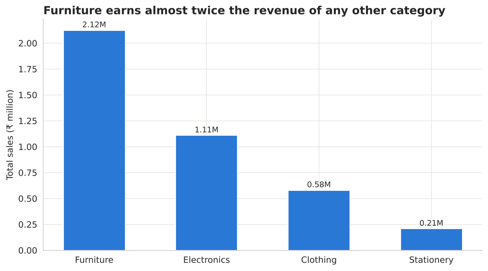
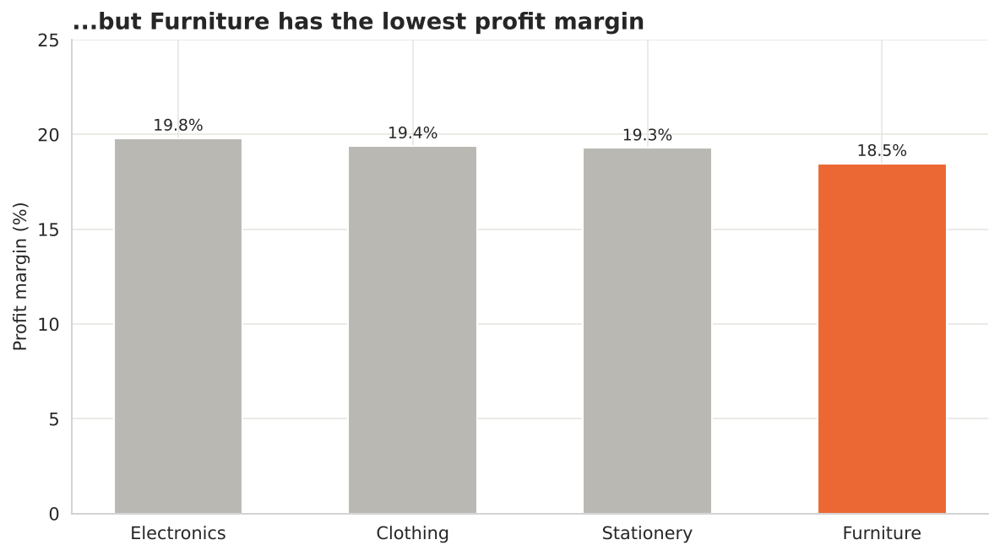
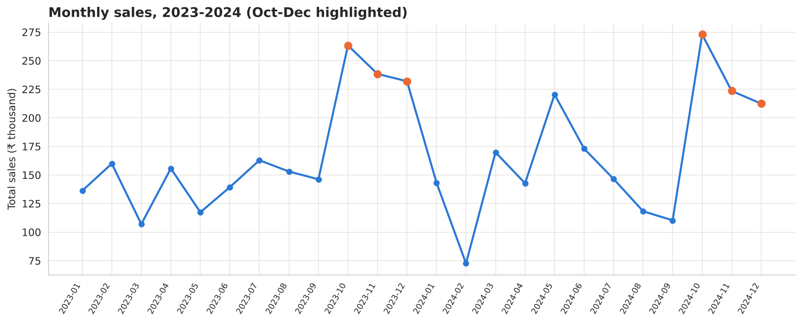
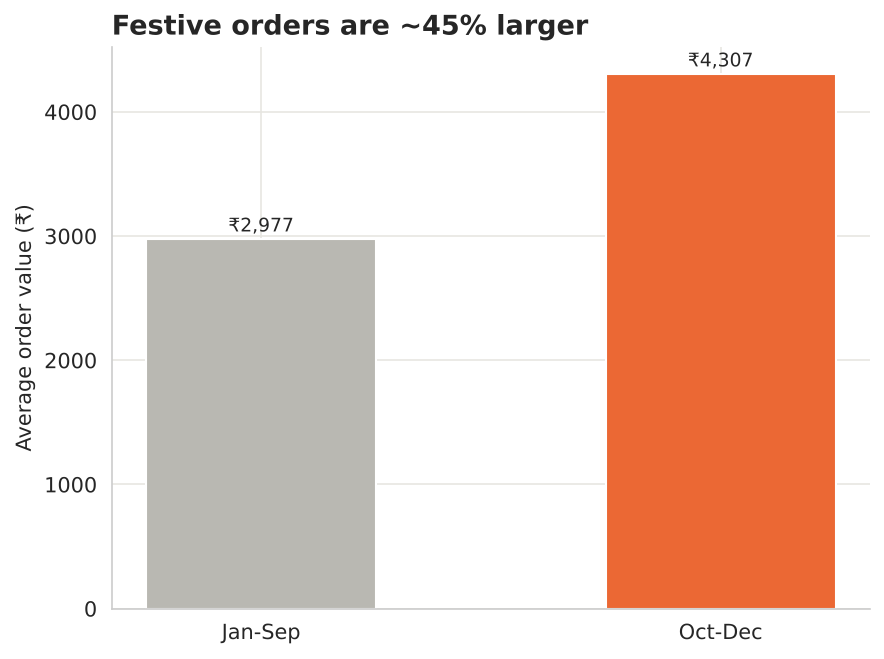
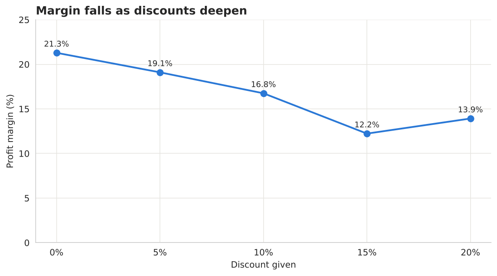
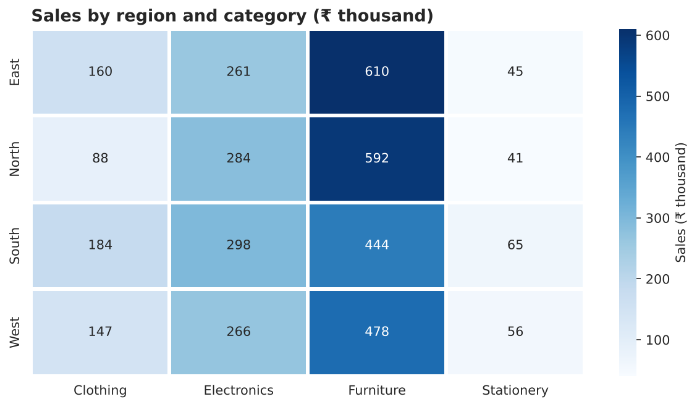

# Retail Sales Analysis (2023-2024)

An end-to-end data analysis project in Python: raw, messy sales data → cleaning → exploratory analysis → charts → business recommendations.

> **Note on the data:** this is a **simulated practice dataset** that mimics a retail company's orders. It is not real company data. The goal of the project is the analysis workflow, not the specific numbers.

## Business question

Where does the revenue come from, where are we actually profitable, and what patterns should guide decisions?

## Dataset

| | |
|---|---|
| Raw rows | 1,218 orders (1,200 after cleaning) |
| Period | Jan 2023 - Dec 2024 |
| Scope | 4 regions, 12 cities, 4 product categories, 3 customer segments |
| Columns | `order_id, order_date, customer_name, customer_segment, region, city, category, product_name, quantity, unit_price, discount, sales, profit` |

## Data cleaning

The raw file was deliberately messy. Problems found and how each was handled:

| Problem | Fix | Why |
|---|---|---|
| Inconsistent `region` / `category` text (`north`, `NORTH`, ` North `) | `str.strip().str.title()` | Pandas treats each spelling as a different value |
| Missing `customer_segment` (25), `city` (15) | Filled with `'Unknown'` | Keeps the order in sales/profit totals |
| Missing `profit` (42) | Filled with the median | Median is robust to outliers |
| 18 duplicate rows | `drop_duplicates()` | Avoids double-counting revenue |
| 6 negative `quantity` values | Absolute value | Sign flipped by data-entry error |
| `sales` inconsistent after quantity fix | Recomputed as `quantity × unit_price` | Keeps the data internally consistent |

## Key findings

1. **Furniture drives the most revenue**: ₹2.12M, almost double the next category (Electronics, ₹1.11M).
2. **...but has the lowest margin**: 18.5% vs 19.3-19.8% for the other categories. The gap is modest (about 1.3 points), but on the largest category it matters.
3. **Regions are close**: East leads at ₹1.08M, but the spread between best and worst region is only about 14%.
4. **Festive season is real**: average order value is ₹4,307 in Oct-Dec vs ₹2,977 the rest of the year (about 45% higher).
5. **Discounts erode margin**: margin falls from 21.3% (no discount) to 12.2% at 15%. The 20% tier (13.9%) is no worse than 15%, so the relationship is not perfectly linear.

## Charts

| | |
|---|---|
|  |  |
|  |  |
|  |  |

## Recommendations

1. Review Furniture pricing and costs, since it is the biggest revenue driver but the least efficient.
2. Keep discounts at or below 10%. Margin falls steeply beyond that.
3. Plan inventory and promotions around Oct-Dec.

## Limitations

- Simulated data, so findings illustrate the method rather than a real business.
- Differences between categories and regions were not tested for statistical significance.
- Missing profit values were filled with the median, which slightly dampens variation.

## Tech stack

Python · pandas · NumPy · Matplotlib · Seaborn · Jupyter Notebook

## Project structure

```
retail-sales-analysis/
├── data/
│   ├── retail_sales_data.csv       # raw, messy data
│   └── retail_sales_cleaned.csv    # output of the cleaning step
├── notebooks/
│   └── retail_sales_analysis.ipynb # full analysis with outputs
├── images/                         # charts used in this README
├── requirements.txt
└── README.md
```

## How to run

```bash
git clone https://github.com/<your-username>/retail-sales-analysis.git
cd retail-sales-analysis
pip install -r requirements.txt
jupyter notebook notebooks/retail_sales_analysis.ipynb
```

Run all cells from top to bottom. The notebook reads the raw CSV, writes the cleaned CSV, and saves the charts to `images/`.
